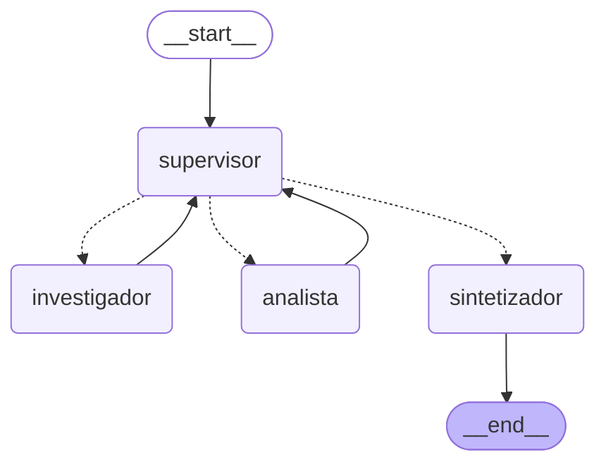

# Pre-entrega 6: Orquestador multi-agente

Prototipo de un **orquestador multi-agente** con LangGraph para *Supermercados del Valle*.
Un **Supervisor** recibe la pregunta del usuario y delega el trabajo en dos especialistas:

- **Investigador**: busca datos en fuentes externas (reseñas de clientes, precios de la competencia y noticias). Las fuentes son simuladas y están en [data/fuentes.json](data/fuentes.json).
- **Analista**: procesa esos datos con un análisis de sentimiento y una comparación de precios.

Cuando el Supervisor valida que la tarea está completa, un **Sintetizador** escribe la respuesta final.

## Diagrama del grafo

Generado con `app.get_graph().draw_mermaid()`:



Las flechas punteadas son **aristas condicionales**: el Supervisor elige a dónde ir. Las flechas llenas son fijas: los especialistas siempre le devuelven el control al Supervisor.

## Estructura

| Archivo | Qué hace |
|---|---|
| [state.py](state.py) | Estado compartido `OrquestadorState`, que hereda de `MessagesState`. |
| [agents/research_agent.py](agents/research_agent.py) | Investigador (`create_react_agent` + herramienta `buscar_en_fuentes`). |
| [agents/analyst_agent.py](agents/analyst_agent.py) | Analista (`create_react_agent` + herramientas `analizar_sentimiento` y `comparar_precios`). |
| [supervisor.py](supervisor.py) | Supervisor con la rúbrica de validación, la función de ruteo y el Sintetizador. |
| [graph.py](graph.py) | Arma el `StateGraph` y lo compila. |
| [main.py](main.py) | Demo por consola que imprime cada paso. |
| [demo.ipynb](demo.ipynb) | Notebook que demuestra el flujo de delegación, ya ejecutado y con las salidas guardadas. |
| [config.py](config.py) | Modelo de lenguaje y límite de pasos. |

## Cómo correrlo

```bash
python -m venv .venv
.venv\Scripts\activate          # Windows
pip install -r requirements.txt
copy .env.example .env          # y completar ANTHROPIC_API_KEY
python main.py
python main.py "¿Cómo está el precio de la leche frente a la competencia?"
```

## Estado compartido

```python
class OrquestadorState(MessagesState):
    next_agent: str                                  # a quién eligió el supervisor
    instruccion: str                                 # tarea concreta para el especialista
    aportes: Annotated[list[Aporte], operator.add]   # quién aportó qué
    pasos: int                                       # contador para cortar bucles
    task_completed: bool                             # True cuando el supervisor da FINISH
```

En `aportes` cada especialista **agrega** un registro `{agente, instruccion, resultado}`. El reducer `operator.add` hace que se sume a la lista en lugar de reemplazarla. Así siempre se sabe qué agente aportó cada información y no se pierde contexto entre turnos.

## Por qué una topología jerárquica (Supervisor)

- **El orden importa.** El Analista necesita los datos del Investigador, así que alguien tiene que coordinar el orden y decidir cuándo pasar al siguiente paso.
- **Un solo punto de decisión.** Solo el Supervisor decide el flujo, así que es fácil seguir y depurar lo que pasa. En el grafo, cada especialista vuelve siempre al Supervisor.
- **Se puede ampliar.** Para sumar un especialista nuevo, se agrega un nodo y una opción más en el `Literal` del Supervisor.

## Cómo se manejan los conflictos y los bucles

1. **Rúbrica de validación.** El prompt del Supervisor tiene una rúbrica que debe cumplirse antes de elegir `FINISH`: que haya datos concretos para cada parte del pedido, que estén los cálculos con números y que los aportes no se contradigan. Si hay una contradicción o falta un dato, el Supervisor vuelve a mandar al especialista que corresponda con una instrucción que dice qué corregir.
2. **Roles acotados.** El Investigador solo busca y el Analista solo calcula, y cada uno tiene únicamente sus herramientas. Así no se pisan entre sí.
3. **Salida estructurada.** El Supervisor responde con un modelo Pydantic con `siguiente: Literal["investigador", "analista", "FINISH"]`, así que no puede elegir un nodo que no existe.
4. **Corte contra el "supervisor infinito".** Hay un contador `pasos` con límite `MAX_PASOS = 6`. Si se alcanza, el flujo termina sí o sí. El prompt también le pide aceptar los datos "no disponibles" en vez de insistir.
5. **Sin contaminación de contexto.** Los especialistas no reciben todo el historial. El Investigador recibe solo la instrucción del Supervisor, y el Analista recibe la instrucción más los resultados del Investigador.

## Ejemplo de ejecución

Pregunta: *"¿Qué opinan los clientes de nuestra yerba y estamos caros o baratos frente a la competencia?"*

```
SUPERVISOR   -> investigador: falta buscar reseñas y precios
INVESTIGADOR    5 reseñas + precios de 4 supermercados
SUPERVISOR   -> analista: hay datos, falta calcular
ANALISTA        60 % de reseñas positivas, +1,61 % sobre el promedio de la competencia
SUPERVISOR   -> FINISH: se cumple la rúbrica
SINTETIZADOR    respuesta final con una recomendación
```

La salida completa está en [demo.ipynb](demo.ipynb).
